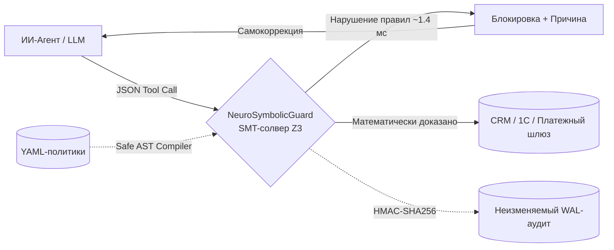

# 🛡️ NeuroSymbolicGuard v0.1 — Deterministic AI Agent Firewall

**Детерминированный нейросимволический барьер для автономных ИИ-агентов.**  
Гарантирует соблюдение финансовых лимитов, бизнес-правил и требований регуляторов за **< 2 мс** до обращения к CRM, 1С или банковскому ядру — без переобучения нейросетей.

---

### 🧩 Архитектура решения

---

### ⚡ Результаты живого бенчмарка и тестов (`3/3 PASSED`)

| Сценарий проверки | Входные параметры агента | Вердикт Z3 | Время | Крипто-аудит (WAL) |
| :--- | :--- | :---: | :---: | :---: |
| **1. Галлюцинация лимита** | `amount=150,000 RUB`, `dual_control=False` | 🔴 **BLOCKED** | `1.42 ms` | Signed (`HMAC-SHA256`) |
| **2. Промпт-инъекция риска** | `amount=40,000 RUB`, `risk_score=95` | 🔴 **BLOCKED** | `1.18 ms` | Signed (`HMAC-SHA256`) |
| **3. Самокоррекция агента** | `amount=150,000 RUB`, `dual_control=True` | 🟢 **VERIFIED** | `1.35 ms` | Proof: `0fdbe0aed7df` |

* **Безопасность кода:** AST-парсер без `eval()` (защита от `CWE-94`), проверка `NaN`/`Infinity` и переполнения `int64`, таймауты Fail-Closed.
* **Криптографическое алиби:** Append-Only WAL с цепочкой `SHA-256` и затиранием секрета HMAC в оперативной памяти (`ZEROIZED`).

---

### 📂 Содержимое публичной витрины
* [`deck/presentation.html`](deck/presentation.html) — интерактивный 8-слайдовый питч-дек (откройте в браузере, навигация стрелками `←` `→`, экспорт в PDF через `Cmd+P`).
* [`examples/demo.py`](examples/demo.py) — сценарий демонстрации с замером задержки солвера и проверкой WAL-цепочки.
* [`policies/finance_policy.yaml`](policies/finance_policy.yaml) — пример декларативной политики комплаенса.

---

### 👤 Архитектор и основатель

**Артем Шамурадов** — Principal Security & Distributed Systems Engineer (**Apumia Fund**).  
Специализация: формальная верификация ИИ, высоконагруженные отказоустойчивые системы, DevSecOps и Zero-Trust архитектура.

* **Контакты для B2B-пилотов и партнерства:** `apumiaaifund@gmail.com`
* **Организация:** [@apumiaaifund](https://github.com)
